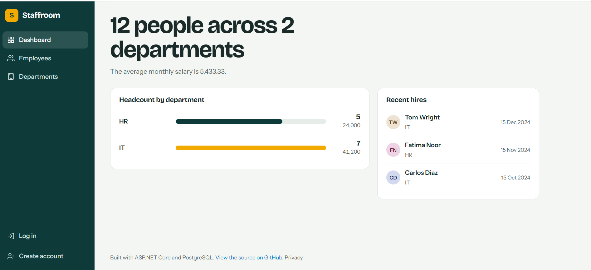
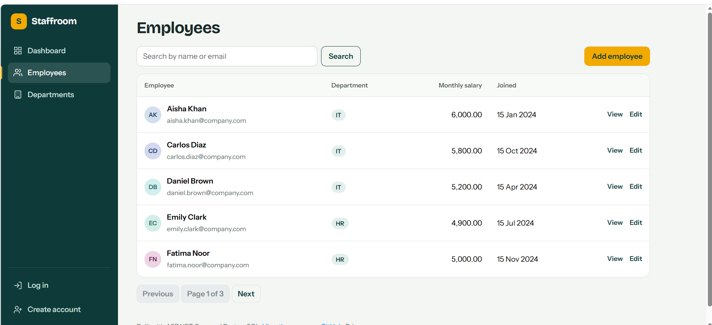
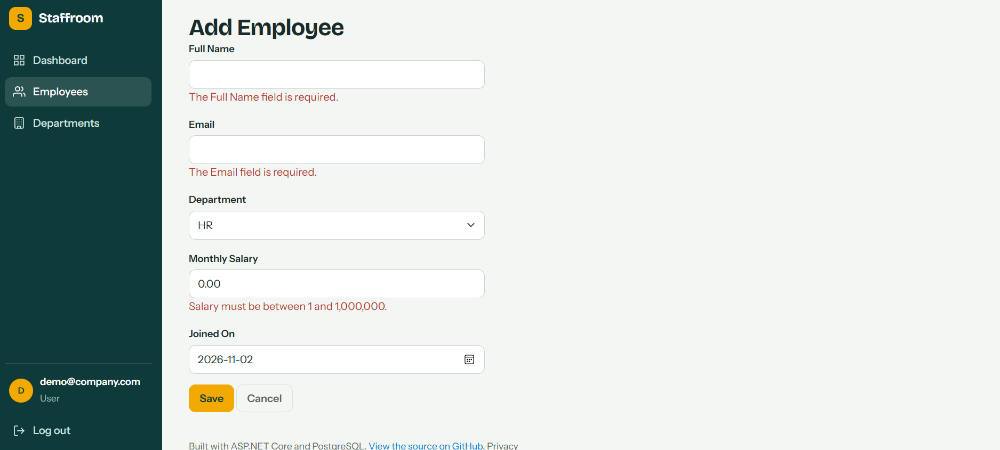
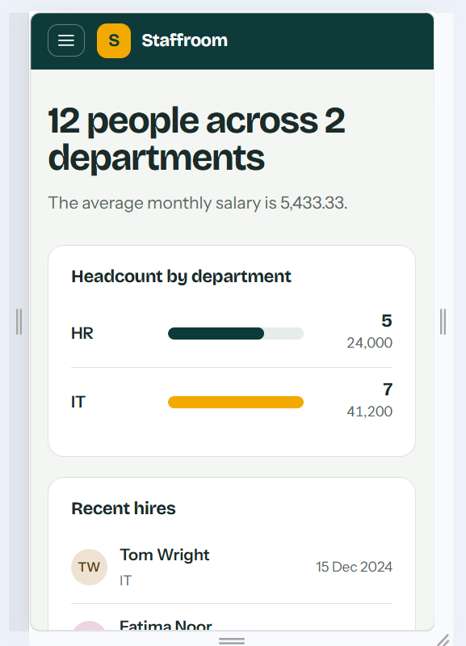

# Staffroom: Employee Management System

[](https://github.com/Mdmustafasalman748/Employee_Management_System_Project/actions/workflows/ci.yml)

A full-stack employee and department manager built with ASP.NET Core MVC, deployed with a CI/CD pipeline.

**Live demo:** https://employee-management-system-project-3.onrender.com

Demo login: `demo@company.com` / `Demo@12345` (can add and edit; deleting is admin-only).

> Hosted on free tiers: if the site has been idle, the first load can take about a minute while it wakes up.




## What it does

- **Employees and departments:** create, view, edit, and delete, with server-side validation.
- **Search and paging:** filter by name or email, five rows per page.
- **Dashboard:** headcount and payroll by department, plus recent hires.
- **Accounts and roles:** registration and login with ASP.NET Core Identity. Any signed-in user can add and edit; deleting and user management are admin-only.
- **CSV export:** download the current search results, with protection against spreadsheet formula injection.
- **Safe deletes:** a department that still has employees can't be deleted, enforced in both the code and the database.
- **Responsive design:** a sidebar layout that collapses into a menu on phones.

| Employees | Validation | Mobile |
|---|---|---|
|  |  |  |

## Tech stack

C#, .NET 10, ASP.NET Core MVC and Razor, Entity Framework Core, ASP.NET Core Identity, SQLite (local) and PostgreSQL (production), xUnit, Docker, GitHub Actions, Render, Neon.

## How it fits together

```
Browser  ->  ASP.NET Core MVC (Docker container on Render)  ->  EF Core  ->  PostgreSQL (Neon)

git push  ->  GitHub Actions (build, test, build Docker image)  ->  Render redeploys main
```

The same code runs against SQLite on a laptop and PostgreSQL in production. The database is chosen from the `ConnectionStrings__DefaultConnection` setting, so nothing in the code changes between environments.

## Run it locally

Requires the .NET 10 SDK.

```bash
dotnet run --project EmployeeManagement.Web
```

The app creates a local SQLite database and seeds sample employees on first start. To also create an admin account, set a password first:

```bash
dotnet user-secrets set "Seed:AdminPassword" "<choose-a-strong-password>" --project EmployeeManagement.Web
```

Run the tests:

```bash
dotnet test
```

Run with Docker:

```bash
docker build -t staffroom .
docker run --rm -p 8080:8080 -e Seed__AdminPassword="<choose-a-strong-password>" staffroom
```

## Configuration

| Setting | Purpose |
|---|---|
| `ConnectionStrings__DefaultConnection` | Database connection. PostgreSQL URLs are converted automatically; defaults to SQLite. |
| `Seed__AdminPassword` | Password for `admin@company.com`. The admin account is only created if this is set. |

## Testing

xUnit tests cover the controllers, validation rules, search and paging, CSV export and its escaping, authorization attributes on protected actions, and the database-provider switch. They run on every push.

## Design decisions and known limitations

- **PostgreSQL schema:** the EF Core migrations in this repo target SQLite, so on PostgreSQL the tables are created from the model at startup. A production system would generate PostgreSQL migrations instead.
- **Free hosting:** the web service sleeps when idle, and the database compute suspends too, so the first request can be slow.
- **Secrets:** the admin password and database URL live only in host environment variables and local user secrets, never in the repository.

## Roadmap

- PostgreSQL migrations instead of create-at-startup
- Audit log of who changed which record
- Pagination and filtering by department
- Integration tests against a real PostgreSQL container
